<p align="center">
  
</p>

<p align="center">
  <a href="mailto:shanxcode@gmail.com?subject=Project%20inquiry"></a>
  <a href="https://wa.me/923277404165"></a>
  <a href="https://www.linkedin.com/in/muhammad-shuban-ali-10075031b/"></a>
  <a href="https://shanxcode.netlify.app/my%20latest%20CV%202026.pdf"></a>
</p>

<br />



I'm **Muhammad Shuban Ali**, a full-stack developer from Gujrat, Pakistan with **3+ years** of building web applications that solve real problems. I take products from idea to launch — designing the interface, building the API and database behind it, and shipping it fast, accessible and easy to maintain. I care about clean code, smooth interactions and interfaces people enjoy using.

```js
const shuban = {
  role: "Full-Stack Developer",
  location: "Gujrat, Pakistan 🇵🇰",
  experience: "3+ years",
  code: {
    frontend: ["React", "Next.js", "TypeScript", "Tailwind CSS", "Vite"],
    backend: ["Node.js", "Express", "PostgreSQL", "MongoDB", "Prisma"],
    tools: ["Git", "Docker", "AWS", "Supabase", "Figma"],
  },
  currentlyBuilding: "Medical management app — React + Capacitor + Supabase",
  openTo: ["Full-time roles", "Freelance projects", "Consulting", "Open-source collaboration"],
  hire: () => "shanxcode@gmail.com",
};
```

<br />



<table>
  <tr>
    <td width="50%" valign="top">
      <h3>🖥️ Full-Stack Web Apps</h3>
      End-to-end products: React / Next.js front ends, Node.js APIs, PostgreSQL or MongoDB, authentication and deployment — one developer, the whole stack.
      <br /><br />
      <code>React</code> <code>Next.js</code> <code>Node.js</code> <code>PostgreSQL</code>
    </td>
    <td width="50%" valign="top">
      <h3>📊 SaaS Dashboards & Admin Panels</h3>
      Data-heavy dashboards for clinics, stores and teams — tables, analytics, roles, orders and billing flows that stay fast as data grows.
      <br /><br />
      <code>React</code> <code>Tailwind CSS</code> <code>Prisma</code> <code>Charts</code>
    </td>
  </tr>
  <tr>
    <td width="50%" valign="top">
      <h3>🎨 Frontend & UI Engineering</h3>
      Pixel-perfect, responsive interfaces built from Figma designs as reusable component systems — accessible, consistent and quick on every device.
      <br /><br />
      <code>TypeScript</code> <code>React</code> <code>Tailwind CSS</code> <code>Figma</code>
    </td>
    <td width="50%" valign="top">
      <h3>⚙️ Backend & REST APIs</h3>
      Clean, well-structured APIs, database design, email and third-party integrations — the reliable engine behind the interface.
      <br /><br />
      <code>Node.js</code> <code>Express</code> <code>Prisma</code> <code>SQL</code>
    </td>
  </tr>
  <tr>
    <td width="50%" valign="top">
      <h3>✨ Interactive & Creative Web</h3>
      Motion design, canvas tools and playful experiences — from real-time design editors to animated interfaces and browser mini-games.
      <br /><br />
      <code>Framer Motion</code> <code>GSAP</code> <code>Canvas</code> <code>SVG</code>
    </td>
    <td width="50%" valign="top">
      <h3>📱 Mobile Apps</h3>
      Cross-platform mobile apps from a single React codebase, with a real-time backend and authentication built in.
      <br /><br />
      <code>React</code> <code>Capacitor</code> <code>Supabase</code>
    </td>
  </tr>
</table>

> 🛠️ Also: feature development and bug fixing on existing codebases, performance tuning and SEO, and deployments on Vercel, Netlify and AWS.

<br />



<p align="center">
  
</p>

<p align="center">
  
</p>

<p align="center">
  <br />
  <br />
  
</p>

<br />



Real products I've built and contributed to:

<table>
  <tr>
    <td width="50%" valign="top">
      <sub>01 · FULL PROJECT</sub>
      <h3><a href="https://www.naqlix.com/">Naqlix ↗</a></h3>
      AI-powered clinic management platform — appointment scheduling, patient records, billing and workflow automation for healthcare teams.
      <br /><br />
      <code>Healthcare</code> <code>AI</code> <code>SaaS</code>
    </td>
    <td width="50%" valign="top">
      <sub>02 · FULL PROJECT</sub>
      <h3><a href="https://aqd-commerce-suite.vercel.app/">AQD Commerce Suite ↗</a></h3>
      All-in-one e-commerce management system — products, orders, customers and analytics in one dashboard.
      <br /><br />
      <code>E-Commerce</code> <code>React</code> <code>Dashboard</code>
    </td>
  </tr>
  <tr>
    <td width="50%" valign="top">
      <sub>03 · FULL PROJECT</sub>
      <h3><a href="https://alfarhan-light-editer-main.vercel.app/">Alfarhan Light Editor ↗</a></h3>
      Interactive editor for designing custom neon light signs — dynamic text styling, colour controls and a real-time preview.
      <br /><br />
      <code>Canvas</code> <code>Interactive</code> <code>Design Tool</code>
    </td>
    <td width="50%" valign="top">
      <sub>04 · CONTRIBUTOR</sub>
      <h3><a href="https://voiceplatter.ai/">VoicePlatter AI ↗</a></h3>
      AI voice platform — shipped new features and fixed critical bugs, improving performance, user experience and stability.
      <br /><br />
      <code>AI</code> <code>Voice Tech</code> <code>Feature Dev</code>
    </td>
  </tr>
  <tr>
    <td width="50%" valign="top">
      <sub>05 · FRONTEND DEVELOPER</sub>
      <h3><a href="https://cdcs.com.pk/">CDCS Pakistan ↗</a></h3>
      Corporate website — responsive UI components and a consistent design system across devices.
      <br /><br />
      <code>Corporate</code> <code>Frontend</code> <code>Responsive</code>
    </td>
    <td width="50%" valign="top">
      <sub>06 · YOUR PROJECT</sub>
      <h3><a href="mailto:shanxcode@gmail.com?subject=Project%20inquiry">Let's build yours ↗</a></h3>
      Have an idea, a product to scale or a codebase that needs a hand? Tell me about it — I reply within 24 hours.
      <br /><br />
      <code>Freelance</code> <code>Full-time</code> <code>Consulting</code>
    </td>
  </tr>
</table>

<details>
  <summary><b>🧪 Earlier projects on GitHub</b></summary>
  <br />

| Project | Description | Tech |
|----------|--------------|------|
| [Amazon Seller Central](https://github.com/shuban620/Amazon-seller-central) | A mock e-commerce seller dashboard. | JavaScript |
| [Glint Website](https://github.com/shuban620/Glint-website) | Responsive business landing page. | HTML, CSS |
| [Result Generator](https://github.com/shuban620/my-result-generater) | Simple web app to generate result cards. | HTML, JS |
| [Calculator](https://github.com/shuban620/calculator) | A basic responsive calculator. | HTML, CSS, JS |

</details>

<br />



<picture>
  <source media="(prefers-color-scheme: dark)" srcset="https://raw.githubusercontent.com/shuban620/shuban620/output/snake-dark.svg" />
  <source media="(prefers-color-scheme: light)" srcset="https://raw.githubusercontent.com/shuban620/shuban620/output/snake-light.svg" />
  
</picture>

<p align="center">
  
</p>

<p align="center">
  
  
</p>

<p align="center">
  
</p>

<br />



**Have a project in mind, or a role that fits?** I'm available for full-time opportunities, freelance projects, consulting and open-source collaboration — and I reply within 24 hours.

<p align="center">
  <a href="mailto:shanxcode@gmail.com?subject=Project%20inquiry"></a>
  <a href="https://wa.me/923277404165"></a>
  <a href="https://www.linkedin.com/in/muhammad-shuban-ali-10075031b/"></a>
  <a href="https://shanxcode.netlify.app/"></a>
</p>

<p align="center">
  
</p>

<p align="center"><i>“Code is like humor — when you have to explain it, it’s bad.”</i></p>
