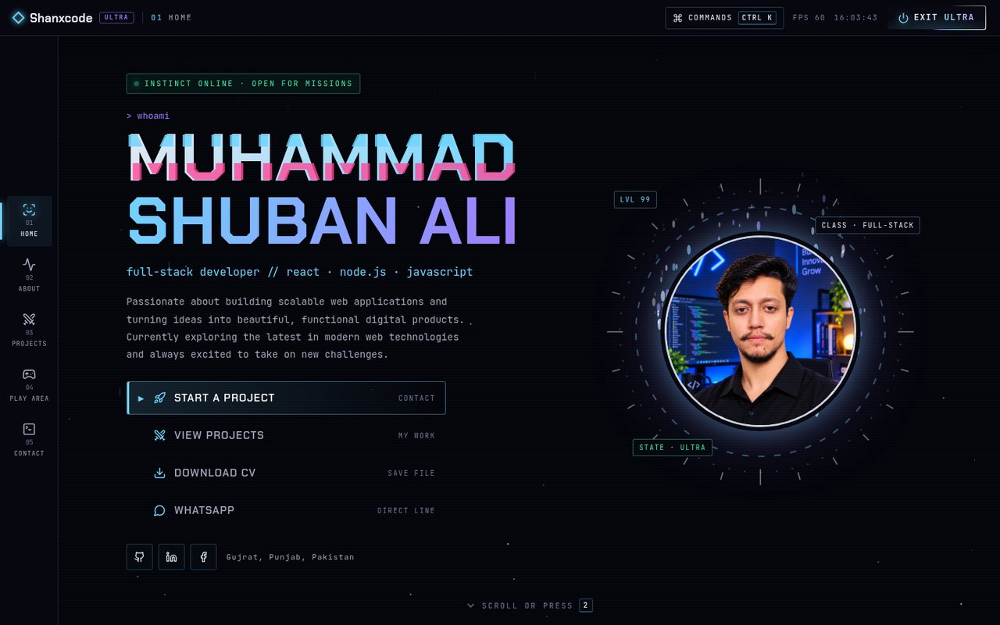
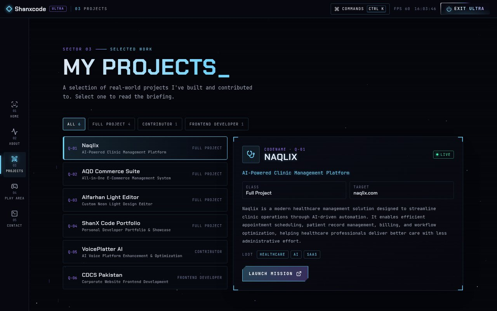
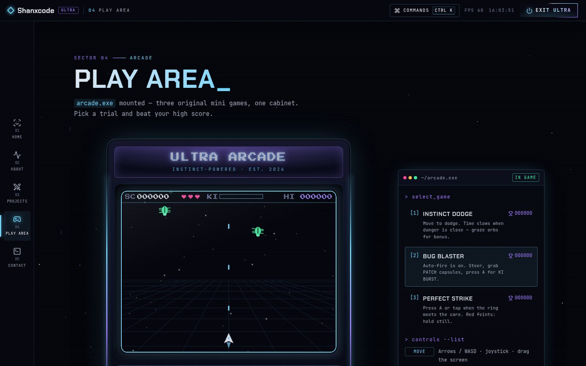

<h1 align="center">👋 Hi, I'm Shuban Ali</h1>

  

  

  <a href="https://shanxcode.netlify.app/"><b>🌐 shanxcode.netlify.app</b></a> — my portfolio, with a hidden <b>⚡ Ultra Mode</b>

I'm a passionate software engineer specializing in **Full Stack Web & Mobile Development** with a strong focus on building clean, responsive, and scalable applications.

---

## ⚡ My Portfolio & Ultra Mode

My portfolio at **[shanxcode.netlify.app](https://shanxcode.netlify.app/)** has two faces. Click **Ultra Mode** in the header and the whole site transforms — after a short "power-up" sequence — into a completely different interface: part terminal, part gamer HUD, part hacker console, with Goku's silver *Ultra Instinct* aura from Dragon Ball as the main inspiration. Same content, a whole new way to explore it.

  

| | What you'll find in Ultra mode |
|---|---|
| 🖥️ **OS-style shell** | Status bar with live FPS and clock, a side rail on desktop and a bottom dock on phones |
| ⌨️ **Keyboard-first** | `Ctrl` / `⌘` + `K` command palette, and keys `1`–`5` jump between pages with an "instant transmission" warp |
| 🎯 **Custom cursor** | A targeting reticle that locks onto buttons and links, with silver afterimages and a ki burst on every click |
| 🧬 **Character-select home** | Glitch-style name, a game menu you can drive with the arrow keys, and a live canvas aura around my photo |
| 📊 **RPG-style About** | Expertise bars that charge up, unlocked achievements, a skill inventory and my journey as a quest log |
| 🗺️ **Mission-board Projects** | Filter by role, read each project's briefing and launch the live site |
| 🕹️ **Arcade cabinet** | Three original mini games — **Instinct Dodge**, **Bug Blaster** and **Perfect Strike** — playable with keyboard, joystick or touch, with saved high scores |
| 💬 **Terminal Contact** | Type `help`, `projects` or `contact` — the terminal walks you through a message and actually emails it to me |

  
  

**Under the hood:** Ultra mode is lazy-loaded, so visitors who never open it download nothing extra. It's fully responsive from 320 px phones to large desktops, respects reduced-motion settings, and pauses its canvas animations when they're off screen.

`React` `Vite` `Tailwind CSS` `Framer Motion` `GSAP` `Canvas 2D` `Web Audio` `Express` `Nodemailer` `Netlify Functions`

---

## 🧠 About Me
- 💻 Skilled in: **HTML, CSS, JavaScript, Bootstrap 5, Tailwind CSS, React, Next.js, TypeScript, PHP, Python, Node.js, Express, MongoDB, PostgreSQL**
- 🌍 Interested in: **Web Apps, SaaS Products, and Mobile App Development**
- ⚙️ Currently working on: **Medical Management App** using React + Capacitor + Supabase
- 🎯 2025 Goal: Contribute more to **open-source projects** and build **developer tools**
- 📫 Reach me at: **shanxcode@gmail.com**
- 🤙🏻 Contact me at: **+923277404165**

---

## 🧰 Tech Stack

**Frontend:**
`HTML` `CSS` `JavaScript` `TypeScript` `React` `Next.js` `Tailwind CSS` `Bootstrap`

**Backend:**
`Node.js` `Express` `PHP` `Python` `MongoDB` `PostgreSQL` `Prisma` `SQL`

**Other Tools:**
`Vite` `Capacitor` `Supabase` `Docker` `AWS` `Figma` `Git` `VS Code`

---

## 🌟 Featured Projects
Real-world products I've built and contributed to:

| Project | Description | Role | Focus |
|----------|--------------|------|-------|
| [Naqlix](https://www.naqlix.com/) | AI-powered clinic management platform — scheduling, patient records, billing and workflow automation. | Full Project | Healthcare · AI · SaaS |
| [AQD Commerce Suite](https://aqd-commerce-suite.vercel.app/) | All-in-one e-commerce management system with product, order and customer tools plus analytics. | Full Project | E-Commerce · React · Dashboard |
| [Alfarhan Light Editor](https://alfarhan-light-editer-main.vercel.app/) | Interactive editor for designing custom neon light signs with a real-time preview. | Full Project | Canvas · Interactive · Design Tool |
| [Shanxcode Portfolio](https://shanxcode.netlify.app/) | My portfolio — including Ultra Mode, the arcade and the terminal contact form. | Full Project | React · Tailwind CSS · Portfolio |
| [VoicePlatter AI](https://voiceplatter.ai/) | AI voice platform — built new features and fixed critical bugs to improve performance and stability. | Contributor | AI · Voice Tech · Feature Dev |
| [CDCS Pakistan](https://cdcs.com.pk/) | Corporate website — responsive UI components and a consistent design across devices. | Frontend Developer | Corporate · Frontend · Responsive |

### 🧪 Earlier Projects on GitHub
| Project | Description | Tech |
|----------|--------------|------|
| [Amazon Seller Central](https://github.com/shuban620/Amazon-seller-central) | A mock e-commerce seller dashboard. | JavaScript |
| [Glint Website](https://github.com/shuban620/Glint-website) | Responsive business landing page. | HTML, CSS |
| [Result Generator](https://github.com/shuban620/my-result-generater) | Simple web app to generate result cards. | HTML, JS |
| [Calculator](https://github.com/shuban620/calculator) | A basic responsive calculator. | HTML, CSS, JS |

---

## 📊 GitHub Activity

---

## 🤝 Connect with Me

  
  
  
  

---

⭐️ *“Code is like humor — when you have to explain it, it’s bad.”*
